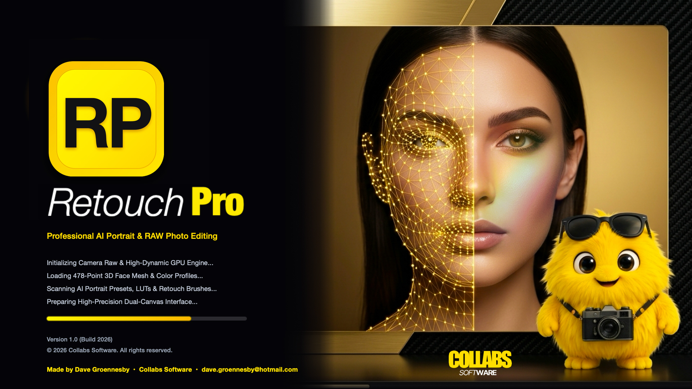

# Collabs Retouch Pro

> *"What if Lightroom's sliders married Evoto's AI and had Luminar as a baby? You'd get Collabs Retouch Pro. And it's FREE."*

The professional, high-performance AI portrait & RAW photo studio engineered by **Dave Groennesby** from **Collabs Software**.



---

## Overview

**Collabs Retouch Pro** is a clean-room, zero-cost, high-performance photo studio uniting the surgical precision of **Adobe Lightroom Classic**, the automated portrait intelligence of **Evoto AI**, and the creative depth of **Skylum Luminar Neo**.

### 0% Fake Sliders — 100% Real Pixel Impact
No CSS filter hacks (`brightness()`, `contrast()`, `blur()`). Every single slider directly calculates mathematical operations on 32-bit `ImageData` pixel buffers and WebGL shaders:
* **True Frequency Separation:** Mathematically decomposes the portrait into low frequency (color & tonality) and high frequency (micro-texture & pores). Smooths skin without plastic artifacts.
* **Dual-Canvas Architecture:** A responsive `displayCanvas` for ultra-smooth 60 FPS viewport interaction (pan, 1:1 zoom, wipe split) paired with background Web Workers for full 4K/6K RAW resolution processing.
* **Interactive Before/After Wipe:** A real-time split line directly swapping raw pixel buffers across the canvas.
* **Live Pixel Inspector Loupe:** Inspects exact `[R, G, B]` values before and after edits with real-time `ΔE` color-difference verification.

---

## Core Modules

### 1. Evoto AI Portrait Retouching
* **Adaptive Blemish & Acne Inpainting:** Local skin median filtering detecting dark spots and inpainting with surrounding skin texture.
* **Frequency Separation (Low / High):** Independent control over color evenness and pore retention.
* **Edge-Preserving Skin Smoothing:** Fast bilateral skin filter preserving natural contours.
* **Specular Glare & Shine Matte:** Detects HSV specular highlights (V > 0.90) and softly diffuses them.
* **Teeth Whitening & Desaturation:** Targeted dental luminance lift with selective yellow desaturation.
* **Eye Brightening & Iris Sharpening:** Enhances catchlights, sharpens limbal rings and sclera clarity.
* **Stray Hair Removal:** Detects fine peripheral hair strands outside the main silhouette.

### 2. Lightroom Core Tone & RAW Sliders
* **White Balance:** Temperature (-100 to +100) & Tint (-100 to +100).
* **Tonal Range:** Exposure (-5.0 to +5.0 EV), Contrast, Highlights, Shadows, Whites, Blacks.
* **Presence & Detail:** Micro-contrast Texture, Mid-tone Clarity, Dehaze, Vibrance, and Saturation.

### 3. 8-Band HSL Mixer & Interactive Curves
* **8 Color Channels:** Red, Orange, Yellow, Green, Aqua, Blue, Purple, and Magenta with independent Hue, Saturation, and Luminance.
* **Interactive 256-LUT Tone Curve:** Graphical spline curve editor generating precise lookup tables applied across the RGB spectrum.

### 4. Luminar AI & Studio Depth
* **Portrait Bokeh Blur:** Depth-aware background defocusing outside the subject mask.
* **Studio Vignette & Grain:** Natural optical falloff and film grain emulation.
* **Limbal Iris Sharpening:** Studio catchlight definition.

---

## Installation & Running

### Linux
Run the native installer to configure desktop entries and menu shortcuts:
```bash
./install-linux.sh
```
Or launch directly:
```bash
python3 launch_retouch_pro.py
```

### macOS
Run the native macOS launcher script (handles Homebrew, Conda, and Apple Silicon / Intel automatically):
```zsh
chmod +x install-mac.command && ./install-mac.command
```
Or launch directly with the universal launcher:
```zsh
python3 launcher.py
```

#### macOS Tkinter Troubleshooting & Fix
If you encounter `No module named '_tkinter'` on macOS (common with minimal Homebrew or Conda base environments):
* **Homebrew:**
  ```bash
  brew install tcl-tk python-tk@3.12
  ```
* **Conda:**
  ```bash
  conda install -c conda-forge tk
  ```
* **Python.org:**
  Download and install official Python installer from [python.org](https://www.python.org/downloads/macos/) which packages full Aqua Tcl/Tk by default.

#### Building Standalone macOS App (PyInstaller)
To bundle a self-contained offline macOS Application with embedded Tkinter:
```bash
pyinstaller Collabs-Retouch.spec
```
The output will be located in `dist/Collabs-Retouch.app`.

### Windows
Run the Windows batch installer:
```cmd
install-windows.bat
```

---

## Credits & License

Engineered with craftsmanship by **Dave Groennesby** — **Collabs Software**.
All rights reserved. Free for editorial, studio, and commercial creative workflows.
